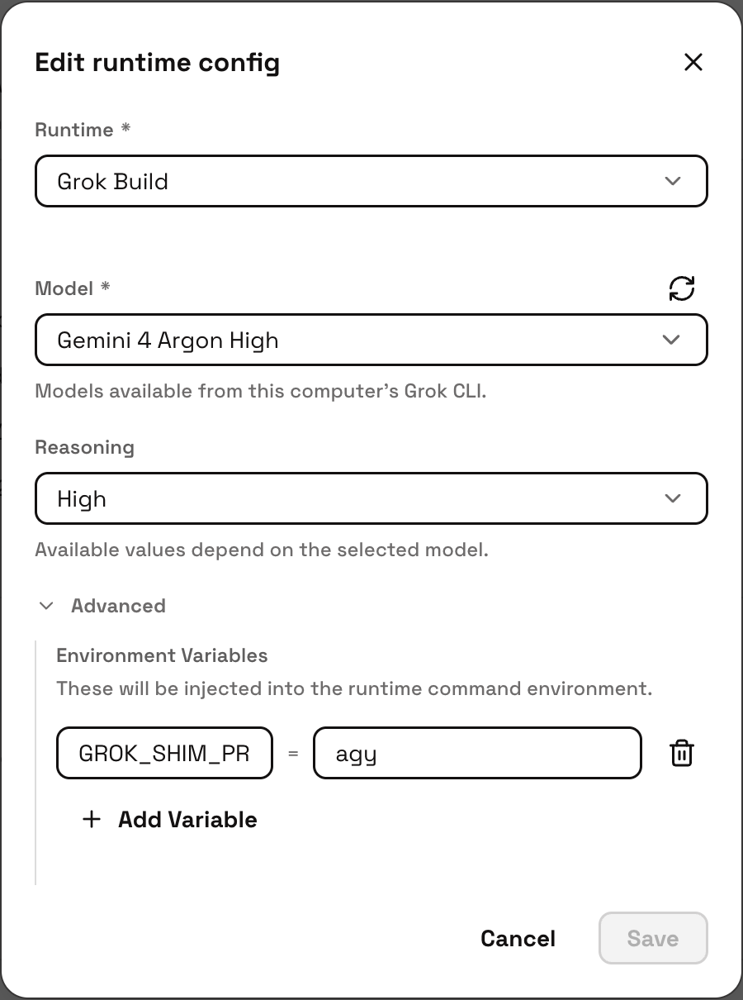
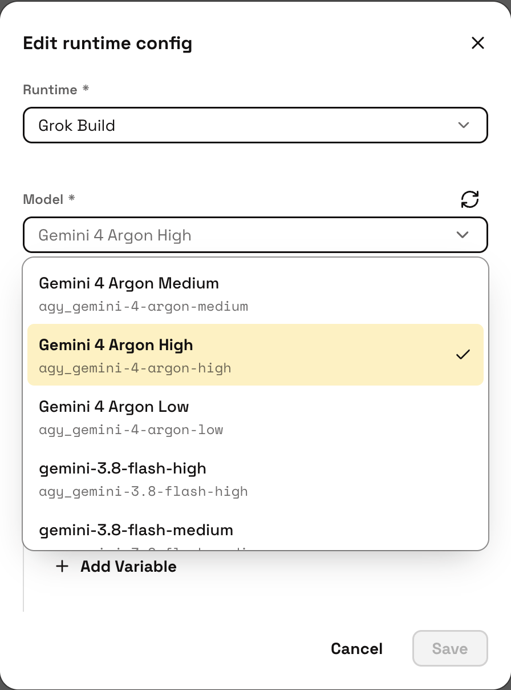

# raft-acp-bridge

**Reuse Raft's Grok Build ACP integration as a general bridge to other ACP
agents.** Raft already communicates with Grok Build through ACP. This project
reuses that connection to run agents such as Antigravity and Maka inside Raft,
without modifying the Raft app.

You select **Grok Build** in Raft's runtime menu. Raft launches a command named
`grok`, which this bridge provides on `PATH`, and the bridge forwards requests
to the backend you configure. The menu still says Grok Build; the agent doing
the work can be Antigravity, Maka or a custom ACP backend.

```text
Raft's Grok Build adapter → grok (this bridge) → your ACP agent
```

The bridge adapts model selection, session handling and messages sent while an
agent is busy. It includes adapters for Antigravity ACP and Maka, plus a custom
backend command setting. The CLI uses Node built-ins only; backend executables
are installed separately. A real Grok Build CLI can coexist with the bridge.

Currently, agy supports only Gemini models; available models depend on the
backend version and account permissions.

## Install on a Mac

Install [Raft Desktop](https://github.com/botiverse/raft-source), Node >=22,
and **one** backend using the [Maka](docs/backends.md#maka) or
[Antigravity](docs/backends.md#antigravity-acp) setup instructions. Maka also has
its own Node version and ACP capability requirements; check that guide first.

From this checkout:

```sh
npm run install:cli
npm run doctor -- --profile maka  # use agy for Antigravity
```

The installer links `bin/grok` at `~/.local/bin/grok`. It preserves existing
non-bridge programs and stops if that location is occupied. Put `~/.local/bin`
earlier on your login-shell `PATH` (for zsh, in `~/.zprofile`):

```sh
export PATH="$HOME/.local/bin:$PATH"
```

If paths differ, copy `.env.sample` to `.env`, edit those paths and rerun the
commands. `SHIM_BIN` selects another installation location; see
[coexisting with Grok](docs/mac-setup.md#coexisting-with-the-real-grok-cli).

Restart Raft's Computer service. In Raft, select the **Grok Build** runtime
and set each agent's environment:

| Backend | Agent environment |
| --- | --- |
| Antigravity | `GROK_SHIM_PROFILE=agy` |
| Maka | `GROK_SHIM_PROFILE=maka` |

In **Advanced → Environment Variables**, click **Add Variable**, enter
`GROK_SHIM_PROFILE` as the name and `agy` or `maka` as the value. Choose a
**Model** and **Reasoning** value, then click **Save**. These screenshots show
an Antigravity agent:

<p>
  
  
</p>

Model IDs in the picker use `agy_` for Antigravity and `maka_` for Maka; these
prefixes are added automatically and require no configuration. Available
models depend on the installed backend.

When no real Grok CLI is installed, the profile alone is enough. If both CLIs
are installed, also set `RAFT_GROK_BACKEND=shim` on bridge-backed agents to
override the default preference for the real CLI.

Send a short message and confirm that the agent returns a reply.

Without `.env`, existing defaults remain in effect. Process and per-agent
variables override `.env`. Relative path settings use the configuration file's
directory, independently of the agent's task directory.

See [Mac setup](docs/mac-setup.md) for all path settings, authentication,
per-machine state and the optional login item. `doctor` checks installation
without starting services, signing in or calling models; it does not replace a
live backend check.

Antigravity compatibility is separate from service authorization. Google's
current terms restrict third-party login use, and permission for personal
subscriptions through this integration has not been established. See
[Antigravity compatibility and service terms](docs/backends.md#compatibility-and-service-terms)
before configuring it. Maka setup is described in the same guide.

## CLI routing

| `RAFT_GROK_BACKEND` | Behavior |
| --- | --- |
| `shim` or `agy` | run this shim |
| `grok` or `real` | run the real Grok CLI; fail if unavailable |
| unset | prefer the real Grok CLI when installed, otherwise run the shim |

`GROK_SHIM_REAL_GROK` selects the real executable explicitly. Otherwise the
shim searches `PATH` and skips its own entry. Commands it does not implement,
such as `grok login`, are delegated when the real CLI is available.

With no profile, ACP initialization can discover the machine-wide backend
catalogue of installed backends, but real session creation requires an explicit profile. The model
prefix must match that profile; the backend receives the unprefixed ID. Legacy
unprefixed IDs are treated as agy.

## Session behavior

- The standing prompt is added to the first meaningful prompt, once per session.
  Empty prompts settle locally without consuming it. It is not reinserted after
  backend context compaction.
- Agy model selections use `session/set_model`. Maka selections use the session's
  `model` and `thinking_level` config options.
- Busy messages are queued for agy. Maka receives `session/inject` when supported;
  unsupported injection or a turn that just ended falls back to the queue.
- A queued message produces a visible notice. The original prompt response is
  held until queued prompts finish so Raft receives their output within its turn.
- Successful session loads retain the requested ID if the backend omits it.
  Failed loads use Raft's missing-session error shape, allowing a fresh session.

Backend capabilities and agy maintenance are documented in
[Backends](docs/backends.md). The UI still labels this runtime Grok Build.

## Runtime configuration

Machine paths are listed in [.env.sample](.env.sample) and the
[Mac setup guide](docs/mac-setup.md). The main behavior settings are:

| Variable | Purpose |
| --- | --- |
| `GROK_SHIM_PROFILE` | `agy` or `maka`, set per agent |
| `RAFT_GROK_BACKEND` | choose shim or real CLI as above |
| `GROK_SHIM_BACKEND_BIN` / `GROK_SHIM_BACKEND_ARGS` | custom backend executable and JSON-array or whitespace-separated arguments |
| `GROK_SHIM_MODELS` | model filter and fallback catalogue, comma-separated `id:Label` |
| `GROK_SHIM_MODEL_FAMILIES` | filter the agy catalogue by family |
| `GROK_SHIM_PROBE=off` | skip agy discovery and use the declared catalogue |
| `GROK_SHIM_INTERJECT=reject` | reject busy messages instead of queueing them |
| `GROK_SHIM_QUEUE_NOTICE` | replace the queue notice; `off` disables it |
| `GROK_SHIM_ENVIRONMENT=off` | omit the shim's environment context block |
| `GROK_SHIM_DEBUG=1` | write shim diagnostics to stderr |

## Development

You can extend the bridge to support more ACP backends. To experiment with your
own agent, set `GROK_SHIM_BACKEND_BIN` and `GROK_SHIM_BACKEND_ARGS`. For a dedicated
integration, follow the adapters in [src/backends/](src/backends/), register its
profile in [src/profiles.js](src/profiles.js) and its model prefix in
[src/models.js](src/models.js), and add fixture-based tests for its model
selection and busy-message behavior.

```sh
npm test
```

Tests use local ACP fixtures and synthetic installation files. The suite does
not require backend sign-in or real model calls.

- [Architecture](docs/architecture.md): source map and protocol responsibilities.
- [Troubleshooting](docs/troubleshooting.md): runtime detection, service ownership
  and common session failures.

## Background

The integration approach and protocol experiments are covered in these articles:

- [Integrating Antigravity CLI into External Programs](https://2bab.me/en/blog/2026-10-18-antigravity-external-integration/) ([中文](https://2bab.me/zh/blog/2026-10-18-antigravity-external-integration/))
- [Integrating Antigravity and Apache/Maka into Raft via ACP](https://2bab.me/en/blog/2026-10-20-raft-runtime-slot/) ([中文](https://2bab.me/zh/blog/2026-10-20-raft-runtime-slot/))

Related projects: [Raft](https://github.com/botiverse/raft-source),
[Maka](https://github.com/apache/maka), and
[antigravity-protocol](https://github.com/2BAB/antigravity-protocol).

## License

This project is licensed under [MIT](LICENSE). External backend software and
services retain their applicable terms. Raft source is distributed under FSL-1.1-ALv2.
