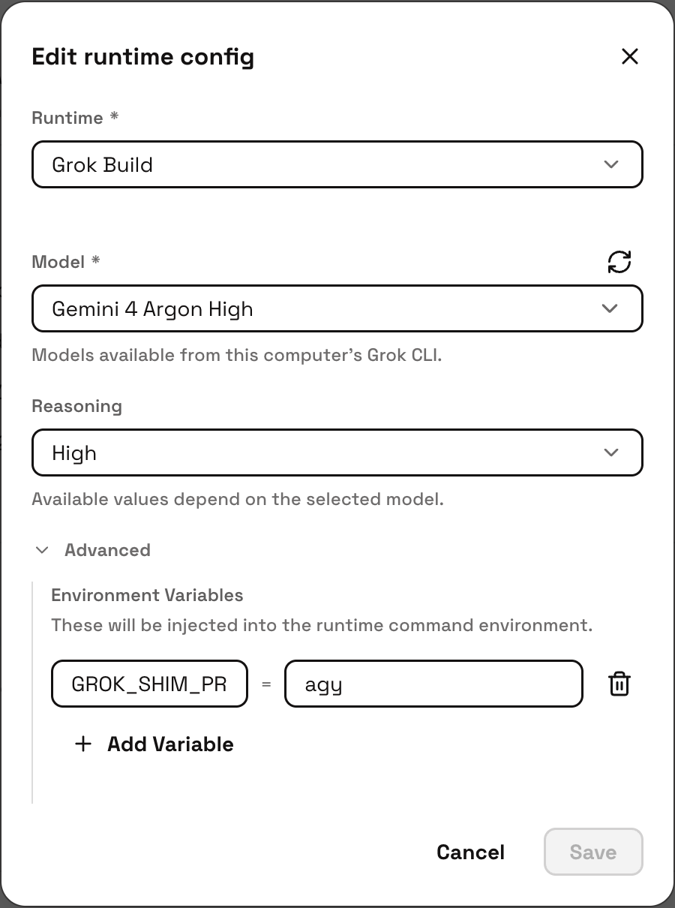
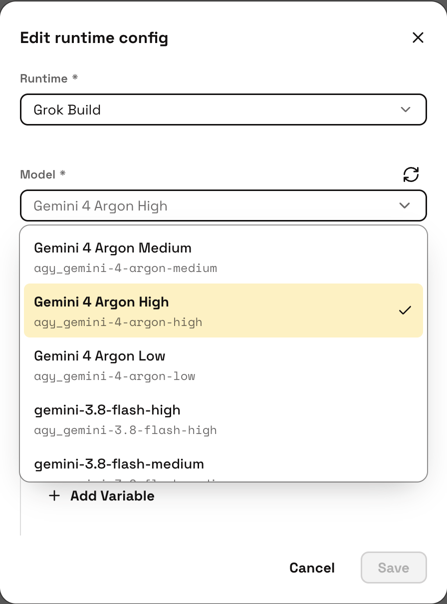

# raft-acp-bridge

**借用 Raft 已有的 Grok Build ACP 接口，把它变成连接其他 ACP agent 的通用桥梁。**
Raft 本来就通过 ACP 调用 Grok Build，本项目复用这条接入路径，
让 Antigravity、Maka 等 agent 也能在 Raft 中运行，无需修改 Raft 应用。

使用时，在 Raft 的 runtime 菜单里选择 **Grok Build**。
Raft 会启动 `PATH` 上名为 `grok` 的命令；本项目提供这个入口，
再把请求转发给你配置的后端。因此，界面上仍显示 Grok Build，
实际工作的 agent 可以是 Antigravity、Maka 或自定义 ACP 后端。

```text
Raft 的 Grok Build 适配器 → grok（本桥接程序）→ 你的 ACP agent
```

桥接程序（shim）负责适配模型选择、会话处理，以及 agent 忙碌时收到的消息。
目前内置 Antigravity ACP 和 Maka 适配器，也支持配置自定义后端命令。
CLI 只使用 Node 内置模块，后端可执行文件需要单独安装。
真实的 Grok Build CLI 也可以与本桥接程序共存。

目前 agy 接入仅验证支持官方 ACP 后端提供的 Gemini 模型，具体可用型号取决于后端版本和账号权限。

## 在 Mac 上安装

先安装 [Raft Desktop](https://github.com/botiverse/raft-source)、Node >=22，
再按 [Maka](docs/backends.md#maka) 或
[Antigravity](docs/backends.md#antigravity-acp) 的说明安装其中一个后端。
Maka 还有自己的 Node 版本与 ACP 能力要求，安装前请先阅读对应说明。

在本仓库目录中运行：

```sh
npm run install:cli
npm run doctor -- --profile maka  # 使用 Antigravity 时改为 agy
```

安装命令会将 `bin/grok` 链接到 `~/.local/bin/grok`。
如果该位置已被其他程序占用，安装会停止，保留原程序。
将 `~/.local/bin` 放到登录 shell 的 `PATH` 前面；使用 zsh 时，写入 `~/.zprofile`：

```sh
export PATH="$HOME/.local/bin:$PATH"
```

如果本机路径与默认值不同，将 `.env.sample` 复制为 `.env`，修改路径后重新运行上述命令。
`SHIM_BIN` 可以指定其他安装位置，详见[与真实 Grok CLI 共存](docs/mac-setup.md#coexisting-with-the-real-grok-cli)。

重启 Raft 的 Computer 服务。在 Raft 中选择 **Grok Build** runtime，
然后为每个 agent 设置环境变量：

| 后端 | Agent 环境变量 |
| --- | --- |
| Antigravity | `GROK_SHIM_PROFILE=agy` |
| Maka | `GROK_SHIM_PROFILE=maka` |

展开 **Advanced → Environment Variables**，点击 **Add Variable**，
变量名填写完整的 `GROK_SHIM_PROFILE`，值填写 `agy` 或 `maka`。
选择 **Model** 和 **Reasoning** 后点击 **Save**。下面以 Antigravity agent 为例：

<p>
  
  
</p>

模型列表中的 ID 会自动带上前缀：Antigravity 使用 `agy_`，Maka 使用 `maka_`，
无需额外填写或配置。实际可选模型取决于本机安装的后端。

没有安装真实 Grok CLI 时，只设 profile 就够了。如果两种 CLI 都已安装，
还需要在使用桥接的 agent 上设置 `RAFT_GROK_BACKEND=shim`，
覆盖默认优先使用真实 Grok CLI 的行为。

发送一条简短消息，确认 agent 能正常回复。

没有 `.env` 时使用默认配置。进程环境变量和 agent 环境变量优先于 `.env`。
相对路径以配置文件所在目录为基准，不受 agent 当前任务目录影响。

完整路径配置、认证、每台 Mac 的运行状态和可选登录项，见 [Mac 安装说明](docs/mac-setup.md)。
`doctor` 只检查安装情况，不启动服务、不登录，也不调用模型；它不能代替真实后端验证。

Antigravity 的技术兼容性与服务使用授权是两件事。Google 当前条款限制通过第三方软件
使用 Antigravity 登录，本集成是否允许使用个人订阅尚未得到确认。
配置前请阅读 [Antigravity 兼容性与服务条款](docs/backends.md#compatibility-and-service-terms)。
同一份指南也包含 Maka 的安装说明。

## CLI 路由

| `RAFT_GROK_BACKEND` | 行为 |
| --- | --- |
| `shim` 或 `agy` | 使用本 shim |
| `grok` 或 `real` | 使用真实 Grok CLI；找不到时直接报错 |
| 未设置 | 找到真实 Grok CLI 时优先使用它，否则使用 shim |

`GROK_SHIM_REAL_GROK` 可以显式指定真实 CLI 的路径。
否则，shim 会搜索 `PATH` 并跳过自身入口。
真实 CLI 可用时，`grok login` 等 shim 未实现的命令会转发给它。

未设置 profile 时，ACP 初始化可以发现本机已安装后端的模型列表；
创建实际会话时则必须明确设置 profile。
模型前缀必须与 profile 一致，转发给后端前会去掉前缀。
为兼容旧配置，没有前缀的模型 ID 按 agy 处理。

## 会话行为

- Standing Prompt 只在会话中第一条有实际内容的 prompt 前添加一次。
  空 prompt 在本地结束，不会消耗这次机会。后端压缩上下文后，也不会再次插入。
- agy 通过 `session/set_model` 切换模型；Maka 使用会话的 `model` 和
  `thinking_level` 配置项。
- agy 忙碌时收到的消息会排队。Maka 支持时使用 `session/inject`；
  不支持注入，或当前回合刚好结束时，回退为排队。
- 消息入队时会显示提示。shim 会等待队列中的 prompt 全部完成后，
  再返回最初的 prompt 响应，让 Raft 在同一回合中收到这些输出。
- 会话恢复成功但后端没有返回 ID 时，保留请求中的 ID。
  恢复失败时，使用 Raft 的“会话不存在”错误格式，让它能够创建新会话。

后端能力和 agy 维护说明见[后端指南](docs/backends.md)。
Raft 界面中的 runtime 名称仍显示为 Grok Build。

## 运行配置

本机路径配置见 [.env.sample](.env.sample) 和 [Mac 安装说明](docs/mac-setup.md)。
主要行为配置如下：

| 环境变量 | 用途 |
| --- | --- |
| `GROK_SHIM_PROFILE` | `agy` 或 `maka`，按 agent 设置 |
| `RAFT_GROK_BACKEND` | 按上表选择 shim 或真实 CLI |
| `GROK_SHIM_BACKEND_BIN` / `GROK_SHIM_BACKEND_ARGS` | 自定义后端可执行文件及参数；参数支持 JSON 数组或按空白分隔的字符串 |
| `GROK_SHIM_MODELS` | 模型过滤条件和探测失败时的备用列表，格式为逗号分隔的 `id:Label` |
| `GROK_SHIM_MODEL_FAMILIES` | 按模型系列过滤 agy 的模型列表 |
| `GROK_SHIM_PROBE=off` | 跳过 agy 模型探测，使用配置声明的列表 |
| `GROK_SHIM_INTERJECT=reject` | agent 忙碌时拒绝新消息，而不是排队 |
| `GROK_SHIM_QUEUE_NOTICE` | 自定义排队提示；设为 `off` 可关闭 |
| `GROK_SHIM_ENVIRONMENT=off` | 不添加 shim 提供的环境信息块 |
| `GROK_SHIM_DEBUG=1` | 将 shim 诊断信息写入 stderr |

## 开发

你可以自行扩展，接入更多 ACP 后端。初步尝试时，通过 `GROK_SHIM_BACKEND_BIN`
和 `GROK_SHIM_BACKEND_ARGS` 指向自己的 agent。需要专门适配时，可以参考
[src/backends/](src/backends/) 下的现有实现，在 [src/profiles.js](src/profiles.js)
注册 profile，并在 [src/models.js](src/models.js) 添加模型前缀，
再使用测试后端验证模型选择和忙碌时的消息处理。

```sh
npm test
```

测试使用本地 ACP 测试后端和合成安装文件，无需登录后端或调用真实模型。

- [架构](docs/architecture.md)：源码结构与协议职责。
- [故障排查](docs/troubleshooting.md)：runtime 检测、服务管理与常见会话错误。

## 背景文章

以下两篇文章介绍了集成方式和协议实验：

- [将 Antigravity CLI 集成到外部程序](https://2bab.me/zh/blog/2026-10-18-antigravity-external-integration/)（[English](https://2bab.me/en/blog/2026-10-18-antigravity-external-integration/)）
- [通过 ACP 把 Antigravity 和 Apache/Maka 接进 Raft](https://2bab.me/zh/blog/2026-10-20-raft-runtime-slot/)（[English](https://2bab.me/en/blog/2026-10-20-raft-runtime-slot/)）

相关项目：[Raft](https://github.com/botiverse/raft-source)、
[Maka](https://github.com/apache/maka)、
[antigravity-protocol](https://github.com/2BAB/antigravity-protocol)。

## 许可证

本项目采用 [MIT](LICENSE) 许可证。外部后端软件与服务适用各自的条款。
Raft 源码采用 FSL-1.1-ALv2 许可证。
